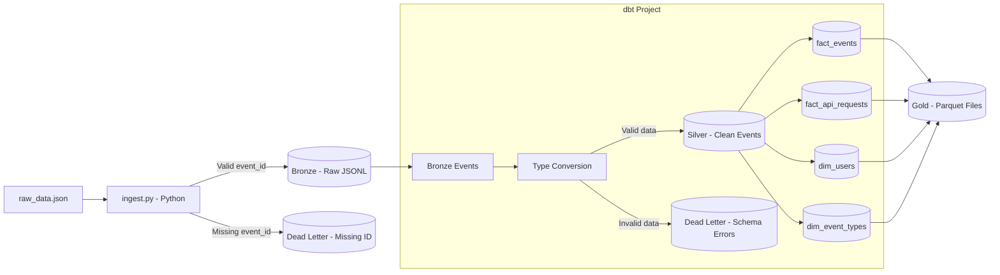

# Simple Data Engineering Pipeline With dbt

This is a project that illustrates how we can build an engineering pipline for a simple json data repository, using the Madallion architecture. The source is a json file and the destination data is in the form of pacquets.

## Architecture



Python handles data ingestion and separates invalid records. dbt cleans, transforms, and organizes the data. Only valid data moves to Silver and Gold.

## Tech Choices

| Layer | Technology | Purpose |
|---|---|---|
| Ingestion | Python + YAML | Read and validate JSON data |
| Transformation | dbt + DuckDB | Clean and transform data using SQL |
| Local database | DuckDB | Run the pipeline locally |
| Storage | Parquet | Store final data efficiently |
| Testing | Python + dbt tests | Check data quality |
| Configuration | YAML | Store project settings |

**Spark or Airflow**

Given the current small data size, there was no immediate need for Spark. This pipeline can easily be move to cloud services without major changes.

## Data Modeling

The project uses the **Medallion Architecture**:

- **Bronze:** Stores raw data in JSONL files, grouped by batch.
- **Silver:** Cleans data, converts data types, and removes duplicates. Keeps one record per `event_id`.
- **Gold:** Stores data in tables designed for reporting and analysis.

### Gold Tables

- `fact_events`: Stores all processed events.
- `fact_api_requests`: Stores API request details, such as status codes and response times.
- `dim_users`: Stores user information.
- `dim_event_types`: Stores the different event types.

### Dead-Letter Data

Invalid records are stored separately instead of entering the main pipeline.

| Reason | Description |
|---|---|
| `missing_event_id` | Event has no valid ID |
| `schema_error` | Event contains invalid data types or timestamps |

### Payload Handling

Different event types may have different JSON structures. The pipeline keeps the original payload and extracts the required fields for each Gold table.

This makes it easier to support new event types.

## How to Run Locally

```bash
# Create and set up virtual environment
python -m venv .venv
source .venv/Scripts/activate

# Install dependencies
pip install dbt-duckdb pyyaml pytest

# Ingest data
python ingestion/ingest.py

# Enter the dbt directory
cd dbt
dbt debug --profiles-dir .         # Check the dbt connection
dbt build --profiles-dir .         # Run transformations and tests
dbt docs generate --profiles-dir . # Generate documentation
dbt docs serve --profiles-dir . --port 8081  # View documentation
```

Alternatively, open `target/index.html` to view the generated documentation.